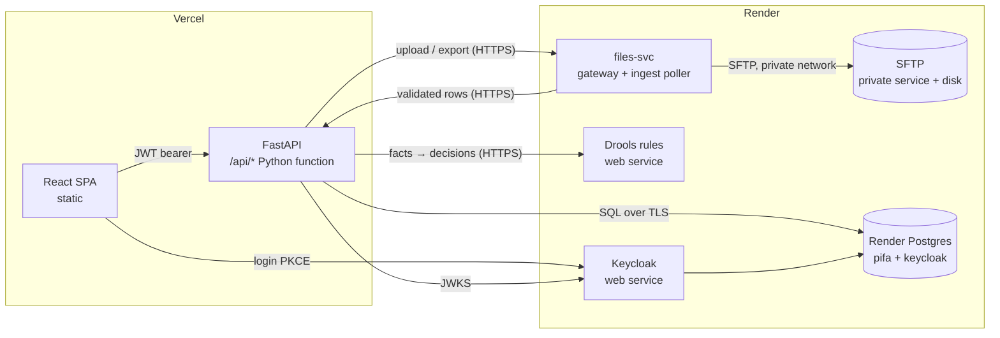

# Phase Plan — Printer Inventory Forecasting & Regional Allocation (PIFA)

Source documents: `docs/PRD — Printer Inventory Forecasting & Regional Allocation.md` (PRD) and `docs/POC_Architecture.md` (Arch).
Target: the PRD's fixed stack (React, FastAPI, Keycloak, Drools, SFTP, PostgreSQL), split across **Vercel** and **Render**. Anything Vercel cannot host runs on Render.

---

## 0. Deployment topology

### 0.1 What runs where

| Component (Arch §4) | Can it run on Vercel? | Host | Render service type |
|---|---|---|---|
| React SPA (Vite, TS, SheetJS) | Yes, static build | **Vercel** | — |
| FastAPI REST API (`/api/*`) | Yes, Python serverless function | **Vercel** | — |
| Keycloak (OIDC, JWT) | No: long-running JVM server | **Render** | Web service (Docker) |
| Drools rules service | No: JVM, long-running | **Render** | Web service (Docker) |
| SFTP server (`/inbound`, `/processed`, `/rejected`, `/outbound`) | No: needs TCP port 22 and a disk | **Render** | Private service (Docker) + persistent disk |
| Ingest worker + file gateway | No: polling loop, needs private network access to SFTP | **Render** | Web service (Python, Docker) |
| PostgreSQL (app DB + Keycloak DB) | Not hosted by Vercel itself | **Render** | Render Postgres (one database: Keycloak in schema `public`, app in schema `pifa`) |



### 0.2 Constraints that shape the design

1. **Render exposes only HTTPS publicly.** A private service can listen on TCP (SFTP on 22), but only other Render services can reach it. So the Vercel API cannot use `paramiko` directly; it calls **files-svc** (a small FastAPI app on Render) over HTTPS, and files-svc talks SFTP on the private network. This replaces Arch's "API → paramiko put" arrow.
2. **Upstream systems cannot drop files into this SFTP from outside Render.** Options: (a) upstream uploads through an authenticated HTTPS endpoint on files-svc (recommended for POC), or (b) use a managed SFTP elsewhere later. Needs business confirmation.
3. **Service-to-service auth.** Vercel API → Drools and → files-svc use a Keycloak **client-credentials** token (client `printer-api-svc`), validated by each Render service. files-svc → API callbacks use the same mechanism.
4. **No free-tier sleep for core services.** Free Render instances spin down when idle (slow first login). Keycloak needs a paid instance with ≥1 GB RAM (Standard recommended); Drools and files-svc Starter; Postgres a paid plan for persistence.
5. **Region alignment.** Put Render services in one region (e.g. Virginia or Frankfurt) and set the Vercel function region to the nearest one (`iad1` or `fra1`) to keep API → DB latency low.
6. **Serverless DB connections.** FastAPI on Vercel uses SQLAlchemy with `NullPool` (or a very small pool) so function instances do not exhaust Render Postgres connections.
7. **Drools packaging.** KIE Server (named in the PRD) is deprecated in current Drools releases. Built as a small **Java 21 + Javalin + Drools 10** service with the same rule packages (`forecast`, `allocation`, `transfer`, `approval`) exposed over REST. KIE Server image remains a fallback if the team requires it. Either way the API contract is `POST /rules/{package}` with facts in, decisions/violations out.

### 0.3 Repository layout (monorepo)

```
web/              React + Vite + TS SPA                       → Vercel (static)
api/              FastAPI app; api/index.py entry              → Vercel (Python function)
rules/            Java + Javalin + Drools, DRL files, Dockerfile→ Render
keycloak/         Dockerfile + realm-export.json (printer-poc) → Render
files-svc/        FastAPI gateway + ingest poller, Dockerfile  → Render
sftp/             Dockerfile (atmoz/sftp), users conf          → Render (private)
db/               Alembic migrations + seed
render.yaml       Render Blueprint for all Render services + Postgres
vercel.json       Build web/, route /api/* to api/index.py, SPA fallback
tests/            api (pytest), rules (JUnit), e2e (Playwright)
docs/
```

### 0.4 Environment variables

| Where | Variables |
|---|---|
| Vercel (web) | `VITE_KEYCLOAK_URL`, `VITE_KEYCLOAK_REALM=printer-poc`, `VITE_KEYCLOAK_CLIENT=printer-web`, `VITE_API_BASE=/api` |
| Vercel (api) | `DATABASE_URL` (Render external URL, `sslmode=require`), `KEYCLOAK_ISSUER`, `KEYCLOAK_AUDIENCE=printer-api`, `SVC_CLIENT_ID`, `SVC_CLIENT_SECRET`, `RULES_URL`, `FILES_URL`, `ALLOWED_ORIGINS` |
| Render keycloak | `KC_DB=postgres`, `KC_DB_URL`, `KC_DB_USERNAME`, `KC_DB_PASSWORD`, `KC_HOSTNAME`, `KC_PROXY_HEADERS=xforwarded`, `KC_HTTP_ENABLED=true`, `KC_HEALTH_ENABLED=true`, `KC_BOOTSTRAP_ADMIN_USERNAME/PASSWORD` |
| Render rules | `KEYCLOAK_ISSUER`, `ALLOWED_CLIENT=printer-api-svc` |
| Render files-svc | `SFTP_HOST` (private hostname), `SFTP_USER`, `SFTP_PRIVATE_KEY`, `API_URL`, `KEYCLOAK_ISSUER`, `SVC_CLIENT_ID`, `SVC_CLIENT_SECRET`, `POLL_SECONDS` |
| Render sftp | authorized public key for `files-svc` only (key-based, chrooted) |

---

## 1. Conventions

- **Tooling:** pnpm + Vite + TypeScript strict + ESLint for `web/`; Python 3.12 + uv/pip, Ruff, mypy, pytest for `api/` and `files-svc/`; Maven + JUnit for `rules/`; Playwright for E2E.
- **Branching:** `main` deploys production on both platforms. PRs get a Vercel Preview; Render preview environments optional (Blueprint `previews`).
- **Definition of done (every task):** typed, request-validated (Pydantic), role and region guarded in the API, every business write passes Drools and writes `audit_log` with a comment, tests added, works on the deployed Preview.
- **Traceability:** FR-* and R-* IDs appear in commit messages and test names.

---

## Phase 1 — Platform and infrastructure

Goal: all services deployed and talking to each other; users can log in with the right role and region.

| # | Task | Refs |
|---|---|---|
| 1.1 | Monorepo scaffold (§0.3), linters, CI (lint, typecheck, unit tests for web/api/rules) | — |
| 1.2 | `render.yaml` Blueprint: Postgres (`pifa` DB; Keycloak in `public`, app in schema `pifa`), keycloak, rules, files-svc, sftp (private + disk); deploy to Render | §0.1 |
| 1.3 | Keycloak image with `realm-export.json`: realm `printer-poc`; clients `printer-web` (public, PKCE, Vercel origins as redirect URIs/web origins), `printer-api` (bearer-only audience), `printer-api-svc` (confidential, client credentials); realm roles `SALES_MANAGER`, `REGIONAL_MANAGER`, `PLANNER`, `HEAD_OF_SALES`, `ADMIN`; `region` user attribute mapped to a token claim; 15-min access token | Arch §4.3, PRD §7 |
| 1.4 | Seed the 11 users (4 SM, 4 RM, Planner, Head, Admin) with regions | PRD §3 |
| 1.5 | `vercel.json`: build `web/`, route `/api/(.*)` to `api/index.py`, SPA fallback to `index.html`, function region near Render; connect Vercel project | §0.2 |
| 1.6 | Alembic schema for Arch §6 tables: `product, cycle, forecast_version, forecast_line, inventory_snapshot, inventory_line, allocation_version, allocation_line, transfer_request, approval, file_ingest, audit_log` plus `rule_config` | Arch §6 |
| 1.7 | `audit_log` append-only: app DB role without UPDATE/DELETE grants plus a trigger that raises on update/delete | Arch §6 |
| 1.8 | FastAPI dependencies `current_user()` (JWT signature, issuer, audience, expiry via cached JWKS), `require_role(...)`, `region_scope(user)`; `GET /api/me`; CORS limited to Vercel domains | Arch §4.2, §7 |
| 1.9 | React app shell: `keycloak-js` PKCE login, token in memory with silent refresh, role-based routes `/sales`, `/regional`, `/planner`, `/head`, `/admin`; stage tracker; JWT claims viewer | FR-C4, FR-C5 |
| 1.10 | Service auth: API obtains and caches a client-credentials token; rules and files-svc verify it | §0.2 |
| 1.11 | SFTP private service with folders `/inbound/{forecast,inventory,allocation}`, `/processed`, `/rejected`, `/outbound`; files-svc health check proves SFTP connectivity | Arch §4.4 |
| 1.12 | Shared audit writer and mandatory-comment validator used by every write route | R-FC-02, PRD §6 |

**Exit criteria:** all 5 roles log in on the Vercel URL and see only their screens; Sales Manager request for another region returns 403; API reaches Postgres, Drools (`/q/health`), and files-svc (which reaches SFTP); audit table rejects UPDATE/DELETE.

---

## Phase 2 — Drools rules service

Goal: all seven rules running on Render and called by the API before any business write.

| # | Task | Refs |
|---|---|---|
| 2.1 | Java + Javalin + Drools project; fact classes (`ForecastLine`, `ModelTotals`, `TransferRequest`, `ApprovalRequest`, `Violation`, `AllocationResult`); REST `POST /rules/{forecast|allocation|transfer|approval}` | Arch §4.5, §8 |
| 2.2 | `forecast` package: R-FC-01 (whole number ≥ 0), R-FC-02 (comment / RM reason), R-FC-03 (RM reject needs comment) | Arch §8 |
| 2.3 | `allocation` package: R-ALLOC-01 (demand ≤ inventory → allocate demand, surplus unallocated; else 25% baseline per region capped at demand, remainder shared by unmet demand, largest-remainder rounding); R-ALLOC-02 (total ≤ inventory). Baseline % and sharing mode passed from `rule_config` | PRD §6, Arch §8 |
| 2.4 | `transfer` package: R-XFER-01 (different regions, 0 < qty ≤ source allocation, comment); R-XFER-02 (no publish before Head approval) | PRD §6 |
| 2.5 | `approval` package: R-APPR-01 (only Head, rejection comment, back to stage 4) | PRD §6 |
| 2.6 | JUnit tests per rule (pass and fail case) incl. worked example: Model A, 100 units, 25 each; East → North 5 gives 30/20/25/25 | PRD §4 |
| 2.7 | Python client in `api/` with timeout, retry and a clear 503 if rules are unreachable (fail closed: no write without a rules decision) | Arch §4.2 |
| 2.8 | Rule catalogue endpoint for the Admin screen | Arch §10.5 |

**Exit criteria:** rules service deployed on Render, every rule ID has a passing and failing test, API refuses writes when Drools reports a violation or is down.

---

## Phase 3 — Forecast flow (stages 1–2)

| # | Task | Refs |
|---|---|---|
| 3.1 | `GET/PUT /api/forecast/{region}?version=1|2` with scoping (SM own V1; RM read all, write own V2; others read) | FR-S1, FR-R2 |
| 3.2 | Shared editable grid with comment modal, V1/V2 switch with deltas, handles ~200 rows | FR-C1, FR-C2 |
| 3.3 | Sales Manager dashboard: own-region V1, submit (locks V1), read-only V2 and allocation, change history, export | FR-S1–S5 |
| 3.4 | `POST /submit`; stage → Regional Review when all 4 submitted | Arch §5 |
| 3.5 | Regional Manager dashboard (forecast): 4 regions side by side, own highlighted, edit own V2 with reason, approve, reject with comment (returns region to its Sales Manager to resubmit) | FR-R1, FR-R2, R-FC-03 |
| 3.6 | Stage → Planning when all 4 approved | Arch §5 |
| 3.7 | Excel flow: template download; browser → `POST /api/files/forecast` → files-svc stores in `/inbound/forecast` → validate (`.xlsx` only, size cap, magic bytes, formulas/macros stripped, parsed with openpyxl) → preview diff in UI (SheetJS) → apply with comment; failures moved to `/rejected` with a reason file | FR-C3, FR-S2, Arch §7 |
| 3.8 | Export to Excel, copy written to `/outbound` | FR-C3 |
| 3.9 | API tests: region isolation, comment required, reject → resubmit loop | PRD §3 |

**Exit criteria:** forecast V1 → V2 completed for all regions via UI and Excel; stage reaches Planning; audit shows every change.

---

## Phase 4 — Allocation flow (stages 3–4)

| # | Task | Refs |
|---|---|---|
| 4.1 | Inventory `GET/PUT /api/inventory`, Excel upload (Product Name + Available Inventory), per-edit comment, snapshot per cycle | FR-P1 |
| 4.2 | Planner dashboard: demand (V1/V2) vs inventory, constrained products flagged | FR-P2 |
| 4.3 | `POST /api/allocation/auto` (Drools R-ALLOC-01), `PUT /api/allocation/v1/{region}/{product}` with comment, allocation Excel upload (Product Name + 4 regions) | FR-P3 |
| 4.4 | `POST /api/allocation/submit` blocked on any R-ALLOC-02 violation; creates Allocation V1, stage → Regional Change | FR-P4 |
| 4.5 | Regional Manager allocation view V1/V2 with inventory and balance | FR-R5 |
| 4.6 | Transfer box (product, from, to, units, comment, live before/after) → `POST /api/transfers` (R-XFER-01); any two regions | FR-R3 |
| 4.7 | Transfer list (who, when, comment, status); undo own transfer while stage 4 is open | FR-R4 |
| 4.8 | Allocation V2 = V1 + transfers; per-model totals preserved | PRD §4 |
| 4.9 | `POST /api/allocation/confirm` per region; stage → Final Approval when all 4 confirm | Arch §5 |
| 4.10 | Tests: never over inventory, transfer sums preserved, undo only by owner in stage 4 | R-ALLOC-02, R-XFER-01 |

**Exit criteria:** Planner approves V1; transfers and confirmations complete; worked example reproduces 30/20/25/25.

---

## Phase 5 — Approval, Head of Sales and Admin (stage 5)

| # | Task | Refs |
|---|---|---|
| 5.1 | `POST /api/allocation/approve` publishes the final allocation (R-XFER-02, R-APPR-01); `/reject` requires comment, returns to stage 4, clears confirmations; Head writes only to `approval` | FR-H3 |
| 5.2 | Head dashboard: read-only V1/V2 data, KPI cards (forecast V1, V2, inventory, allocated, transfers pending), region comparison, transfer review | FR-H1, FR-H2 |
| 5.3 | Published allocation export written to SFTP `/outbound` via files-svc and downloadable in UI | Arch §4.4 |
| 5.4 | `GET /api/audit` role-scoped; audit screen with filters (role, entity, text) and export | FR-H4, FR-A4 |
| 5.5 | Admin: users/roles/regions (read from Keycloak Admin API with a service account), stage advance/reset with logged reason, rule catalogue, read-only data | FR-A1, FR-A2, FR-A4 |
| 5.6 | Integration health: Keycloak, SFTP (via files-svc), Drools, API, DB | FR-A3 |

**Exit criteria:** approve publishes with 0 over-inventory and 0 unapproved; reject loops to stage 4 with comment; Admin overrides are audited.

---

## Phase 6 — Hardening, E2E and release

| # | Task | Refs |
|---|---|---|
| 6.1 | Playwright E2E against the deployed Vercel + Render stack: one full cycle with all 11 users, including each rejection path | PRD §2 |
| 6.2 | Security: TLS end to end (Vercel and Render HTTPS, Postgres `sslmode=require`), Keycloak brute-force protection, strict redirect URIs, CORS, security headers, SFTP key-only and chrooted, secrets only in platform env stores | Arch §7 |
| 6.3 | Performance: 200-product grids < 2 s; check Vercel → Render latency, cold starts, DB indexes | PRD §7 |
| 6.4 | Ops: Render health checks on every service, Postgres backups enabled, log drains, uptime check on Keycloak | — |
| 6.5 | Demo reset/seed command; rotate seed passwords for production | — |
| 6.6 | Docs: README (local dev with `docker compose` for the Render pieces, deploy steps for both platforms), user guide per role, rule catalogue, PRD metrics → evidence | PRD §2 |

**Exit criteria (PRD §2):** one full cycle with all 5 roles and no spreadsheets; 100% of edits commented; 0 published allocations over inventory; 0 published without Head approval.

---

## Local development

`docker compose` still runs the Render pieces locally (keycloak, postgres, rules, files-svc, sftp) as in Arch §11. The SPA runs with `pnpm dev` and the API with `uvicorn`, matching what Vercel serves.

## Requirement coverage map

| Area | Phase |
|---|---|
| FR-C1–C3 | 3 · FR-C4–C5 | 1 |
| FR-S1–S5, FR-R1–R2 | 3 |
| FR-R3–R5, FR-P1–P4 | 4 |
| FR-H1–H4, FR-A1–A4 | 5 |
| R-FC-01..03 | 2, 3 · R-ALLOC-01/02 | 2, 4 · R-XFER-01/02 | 2, 4, 5 · R-APPR-01 | 2, 5 |
| Audit, security, performance | 1, 6 |

## Risks

| Risk | Mitigation |
|---|---|
| SFTP on Render is not reachable from outside Render | files-svc HTTPS gateway; upstream uses HTTPS upload or a managed SFTP later (needs confirmation) |
| Two platforms add latency and more moving parts | Same geographic region; health panel; fail-closed rules client |
| Keycloak memory and cold start | Paid Render instance (≥1 GB RAM), health check, no free tier |
| Serverless functions exhaust DB connections | `NullPool`/small pool; Render Postgres connection limit monitored |
| KIE Server deprecated | Javalin + Drools service with same packages and REST contract |
| Allocation weighting rules may change | Baseline % and sharing mode in `rule_config`, passed to Drools |
| One region blocks the cycle | Admin stage override, audited |
