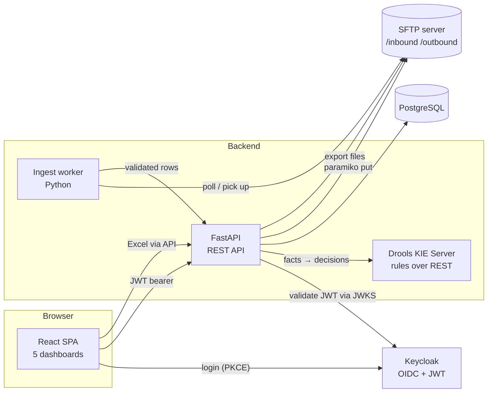
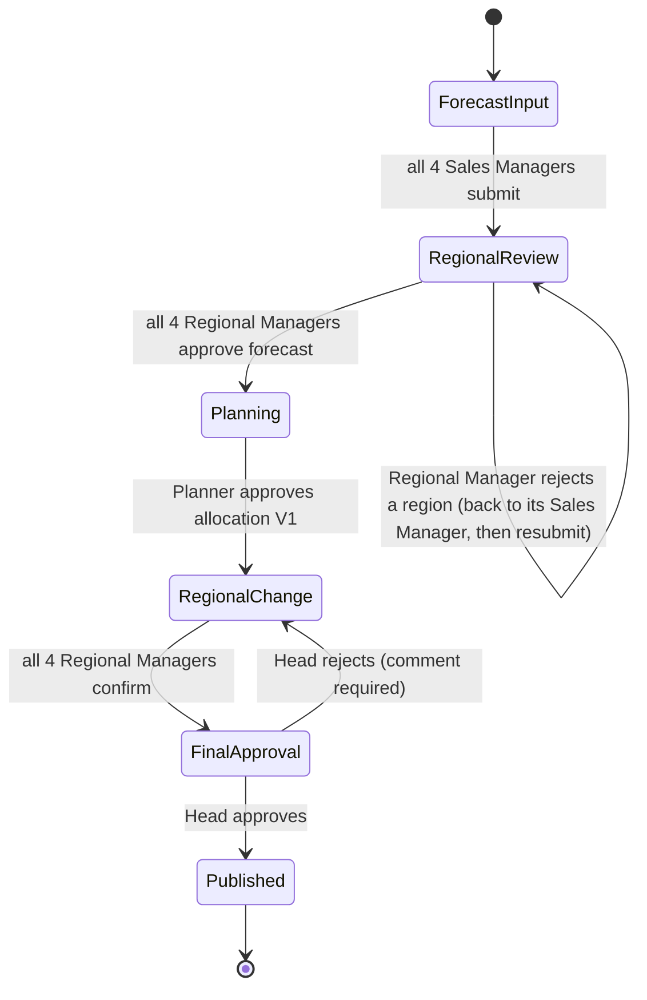

# POC Architecture — Printer Inventory Forecasting & Regional Allocation

Date: 22 Oct 2026 · Owner: @Shubham Rangdal

## 1. Purpose and scope

Forecasts may not match regional sales needs, while limited printer inventory must be shared fairly. Manual changes make approvals and stock movements hard to track.

This POC proves one end-to-end flow:

1. Sales Managers prepare model-wise forecasts for their own region (North, East, West, South).
2. Regional Managers review and revise forecasts, with a reason for every change.
3. Planner uploads inventory, reconciles revised demand with stock and allocates.
4. Regional Managers adjust the allocation by moving units between two regions.
5. Head of Sales approves only the final allocation, which is then published.

Every value carries a version (V1 / V2), a comment, a timestamp and an approval status.

**Technology (fixed for the POC)**

| Concern | Choice |
|---|---|
| Frontend | React (Vite, TypeScript), SheetJS for Excel preview |
| Backend API | Python 3.12, FastAPI |
| Authentication / authorization | Keycloak (OIDC) issuing JWT; API validates via JWKS |
| Business rules | Drools (KIE Server, REST) |
| File exchange | SFTP server (Excel in / out) |
| Database | PostgreSQL |

> The static pages delivered with this document (`index.html`) are a clickable mock of the React UI. They use in-browser storage and a simulated login only.

## 2. Roles and data visibility

| Role | Count | Sees | Can change |
|---|---|---|---|
| Sales Manager | 4 (one per region) | Own region only | Own region forecast V1 |
| Regional Manager | 4 (one per region) | All four regions | Own region forecast V2; allocation transfers between regions |
| Planner | 1 | All regions + inventory | Inventory, allocation V1 |
| Head of Sales | 1 | Everything | Approve / reject final allocation only |
| Admin | 1 | Everything + audit + users | Workflow controls, read-only on business data |

Visibility is enforced in the API, never only in the UI (see section 7).

## 3. Logical architecture



**Why Drools is a separate service:** Drools runs on the JVM. The Python API calls it as a rules service (KIE Server REST), sending facts (forecast lines, inventory, transfer request) and receiving decisions (valid/invalid, computed allocation, violations).

## 4. Components

### 4.1 React SPA
- Login with `keycloak-js` (Authorization Code + PKCE). Access token kept in memory.
- Role-based routing from the `realm_access.roles` claim: `/sales`, `/regional`, `/planner`, `/head`, `/admin`.
- Shared components: version switch (V1/V2), editable grid with comment modal, Excel upload with preview, audit table, stage tracker.

### 4.2 Python API (FastAPI)
- Dependency `current_user()` validates the JWT (signature, issuer, audience, expiry) using Keycloak JWKS.
- Dependency `require_role(...)` and `region_scope(user)` guard every route.
- Services: forecast, inventory, allocation, transfer, approval, audit, files.
- Calls Drools before every write that changes business data.

### 4.3 Keycloak
- One realm `printer-poc`, one client `printer-web` (public, PKCE) and one `printer-api` (bearer-only).
- Realm roles: `SALES_MANAGER`, `REGIONAL_MANAGER`, `PLANNER`, `HEAD_OF_SALES`, `ADMIN`.
- User attribute `region` (North/East/West/South) mapped into the token as a claim.

Sample access-token claims:

```json
{
  "iss": "https://keycloak.example.com/realms/printer-poc",
  "sub": "5b1c…",
  "preferred_username": "rm.north",
  "realm_access": { "roles": ["REGIONAL_MANAGER"] },
  "region": "North",
  "exp": 1792684800
}
```

### 4.4 SFTP
- Folders: `/inbound/forecast`, `/inbound/inventory`, `/inbound/allocation`, `/processed`, `/rejected`, `/outbound`.
- Browser uploads go to the API, which stores the file on SFTP (audit copy) and parses it.
- Ingest worker also picks up files dropped directly by upstream systems, validates them and moves them to `/processed` or `/rejected` with a reason file.
- Exports (approved allocation, audit extract) are written to `/outbound`.
- Key-based authentication, one SFTP user per integration, chrooted.

### 4.5 Drools
Rule packages: `forecast`, `allocation`, `transfer`, `approval`. Rules are versioned and deployed as a KJAR. See section 8.

### 4.6 PostgreSQL
See section 6.

## 5. Workflow and state machine



| # | Step | Actor | Output version |
|---|---|---|---|
| 1 | Forecast input | Sales Manager | Forecast V1 |
| 2 | Regional review | Regional Manager | Forecast V2 (with reasons) |
| 3 | Planning | Planner | Inventory snapshot, Allocation V1 |
| 4 | Regional change | Regional Manager | Allocation V2 (transfers) |
| 5 | Final approval | Head of Sales | Published allocation |

Forecasts go from Regional Managers straight to Planning; only the final allocation needs Head of Sales approval.

## 6. Data model (PostgreSQL)

| Table | Key columns |
|---|---|
| `product` | id, name (unique) |
| `cycle` | id, name, stage, created_at |
| `forecast_version` | id, cycle_id, region, version_no (1/2), status (draft/submitted/approved), updated_by |
| `forecast_line` | version_id, product_id, qty |
| `inventory_snapshot` | id, cycle_id, source_file, uploaded_by, created_at |
| `inventory_line` | snapshot_id, product_id, qty |
| `allocation_version` | id, cycle_id, version_no (1/2/final), status |
| `allocation_line` | version_id, product_id, region, qty |
| `transfer_request` | id, cycle_id, product_id, from_region, to_region, qty, comment, requested_by, status |
| `approval` | id, cycle_id, entity, decision, comment, decided_by, decided_at |
| `file_ingest` | id, path, kind, status, message, received_at |
| `audit_log` | id, ts, user, role, region, entity, version, product_id, before_qty, after_qty, comment, status |

`audit_log` is append-only (no UPDATE/DELETE grants).

## 7. Security

1. **Authentication:** Keycloak OIDC; short-lived JWT (15 min) plus refresh.
2. **Authorization:** role from `realm_access.roles`; region from the `region` claim.
3. **Row scoping in the API (not the UI):**
   - Sales Manager: every query adds `WHERE region = :claim_region`.
   - Regional Manager: read all regions; write only where `region = :claim_region` (forecast V2). Transfers may name any two regions.
   - Head and Admin: read all; Head may only write to `approval`.
4. **Mandatory comment:** the API rejects any write to forecast, inventory, allocation or transfer without a non-empty comment.
5. **Files:** Excel only (`.xlsx`); MIME and extension check, size limit, formula/macros stripped, parsed with `openpyxl` in a sandboxed worker.
6. **Transport:** TLS everywhere; SFTP key-based only.

## 8. Drools rules (POC set)

| ID | Rule |
|---|---|
| R-FC-01 | Forecast quantity must be a whole number ≥ 0. |
| R-FC-02 | Every forecast change needs a comment; Regional Manager revision needs a reason. |
| R-FC-03 | A Regional Manager may approve or reject a regional forecast; rejection needs a comment and returns it to that region's Sales Manager, who revises and resubmits. |
| R-ALLOC-01 | If revised demand ≤ inventory for a model, allocate the demand; surplus stays unallocated. Otherwise start from a 25% per-region baseline (capped at that region's demand) and share the remaining units by unmet demand. The baseline percentage and sharing rule are configurable in Drools and may change as needed. |
| R-ALLOC-02 | Sum of regional allocations per model must not exceed available inventory. |
| R-XFER-01 | Transfer moves units between two different regions; quantity ≤ source allocation; comment required. |
| R-XFER-02 | A transfer cannot be published until Head of Sales approves. |
| R-APPR-01 | Only Head of Sales can approve or reject the final allocation; rejection needs a comment and returns to Regional change. |

Example DRL:

```drl
rule "R-ALLOC-02 allocation within inventory"
when
    $m : ModelTotals( allocated > inventory )
then
    insert( new Violation( "R-ALLOC-02", $m.getProduct(),
        "Allocated " + $m.getAllocated() + " exceeds inventory " + $m.getInventory() ) );
end

rule "R-XFER-01 transfer within source allocation"
when
    $t : TransferRequest( from == to || qty <= 0 || qty > sourceQty || comment == null || comment.trim().isEmpty() )
then
    insert( new Violation( "R-XFER-01", $t.getProduct(), "Invalid transfer" ) );
end
```

## 9. API outline

| Method | Path | Roles |
|---|---|---|
| GET | `/api/me` | all |
| GET / PUT | `/api/forecast/{region}?version=1\|2` | SM (own, V1), RM (read all, write own V2), Planner/Head/Admin (read) |
| POST | `/api/forecast/{region}/submit` | SM |
| POST | `/api/forecast/{region}/approve` | RM (own) |
| POST | `/api/forecast/{region}/reject` | RM (own); comment required |
| POST | `/api/files/{kind}` (forecast / inventory / allocation) | SM, RM, Planner |
| GET / PUT | `/api/inventory` | Planner (write), others read |
| POST | `/api/allocation/auto` | Planner (calls Drools R-ALLOC-01) |
| PUT | `/api/allocation/v1/{region}/{product}` | Planner |
| POST | `/api/allocation/submit` | Planner |
| POST | `/api/transfers` | RM |
| POST | `/api/allocation/confirm` | RM |
| POST | `/api/allocation/approve` / `reject` | Head |
| GET | `/api/audit` | role-scoped; Admin full |
| POST | `/api/admin/stage` | Admin |

## 10. Features per dashboard

### 10.1 Sales Manager dashboard (4 users, one region each)
- Sees only own region; other regions are not returned by the API.
- Forecast V1 grid by product with editable quantities.
- Upload Excel (Product Name + forecast quantity), preview of changes before applying, download template.
- Comment required for every edit and every upload.
- Switch V1 / V2 to see what the Regional Manager revised (read-only, with deltas).
- Submit region forecast to the Regional Manager; revise and resubmit if the Regional Manager rejects it.
- Read-only own-region allocation once Planner has allocated.
- Change history for own region.
- Export to Excel.

### 10.2 Regional Manager dashboard (4 users)
- Sees all four regions side by side; own region highlighted.
- Edits only own region in Forecast V2, with a reason for every change; V1 vs V2 delta shown.
- Upload Excel for own region revision; comment required.
- Approve or reject own region forecast (rejection needs a comment and returns it to the Sales Manager); moves to Planning when all four are approved.
- Allocation view V1 (Planner) / V2 (after transfers) with inventory and balance.
- **Transfer box:** choose product, "reduce from" region, "increase to" region, units and comment (example: North → East, 5 units). Live preview of before/after. Undo own transfer.
- List of transfers with who, when, comment and status.
- Confirm allocation review (goes to Head when all four confirm).
- Change history; export to Excel.

### 10.3 Planner dashboard (1 user)
- Upload inventory Excel (Product Name + Available Inventory), edit inventory with comments, template download.
- Demand vs inventory per product (V1 or V2 demand), flags constrained models.
- Auto-allocate according to revised forecast (Drools R-ALLOC-01: 25% baseline when stock is constrained; surplus stays unallocated); manual edit of any cell with comment.
- Upload allocation Excel (Product Name + four regions).
- Validation: allocation per model must not exceed inventory.
- Approve and send allocation V1 to Regional Managers.
- Sees V2 after regional transfers (read-only), change history, export.

### 10.4 Head of Sales dashboard (1 user)
- Read-only view of all forecasts (V1 / V2) and allocations (V1 / V2) for all regions.
- KPI cards: forecast V1, forecast V2, inventory, allocated, transfers pending.
- Region comparison bars.
- Review transfers (who, from → to, units, reason).
- Approve (publishes approved totals) or reject with comment (returns to Regional change).
- Full audit trail; export.

### 10.5 Admin dashboard (1 user)
- Users, roles and region mapping (Keycloak view).
- Workflow stage control (advance / reset for demo and recovery).
- Integration health: Keycloak, SFTP, Drools, API.
- Drools rule catalogue.
- All data (forecast V1/V2, inventory, allocation V1/V2) read-only.
- Audit dashboard: filter by role, entity, free text; export.

### 10.6 Common to all dashboards
- V1 / V2 version switch.
- Excel upload with Product Name (where the role may edit) and Excel export.
- Edit by cell with required comment (before, after, user, time, status are recorded).
- Stage tracker showing the 5 workflow steps.
- JWT claims viewer (POC only).

## 11. Deployment (POC)

`docker compose` with: `keycloak` (+ `postgres-kc`), `postgres`, `api` (FastAPI/uvicorn), `web` (nginx serving the React build), `drools` (KIE Server), `sftp` (e.g. `atmoz/sftp`), `ingest` (Python worker).

## 12. Decisions and remaining assumptions

Decisions confirmed on 22 Oct 2026:

- Sales Managers enter and edit forecast V1 for their own region.
- A Regional Manager can transfer units between any two regions.
- The 25% per-region split is kept as the baseline rule when stock is constrained; the rule may change as needed, so it is configurable.
- A Regional Manager can approve or reject a regional forecast; a rejection returns it to the Sales Manager.
- Surplus stock (demand below inventory) stays unallocated.
- Excel is the only upstream file format.

Remaining assumptions and open items:

- Expected number of products per cycle (assumed up to about 200).
- Single planning cycle per run; multi-cycle history is out of POC scope.
- Out of scope: notifications, SSO with a corporate IdP, high availability.
